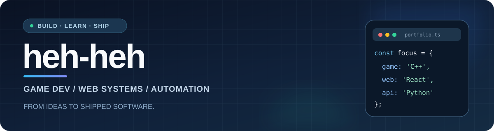

<!-- GitHub Profile README | https://github.com/heh-heh -->

### 게임 로직부터 실제 서비스 운영까지, 직접 만들고 개선하는 개발자

C/C++ 기반 게임 개발을 중심으로 **웹 · 백엔드 · 데이터 자동화 · 클라우드 운영**까지 경험을 넓혀가고 있습니다.

---

## 🎮 Interactive Portfolio — Developer's Quest

**프로젝트를 게임처럼 탐험해 보세요.** 캐릭터 창, 퀘스트 로그, 스킬 트리, 업적 도감으로 기술과 개발 경험을 정리한 인터랙티브 포트폴리오입니다.

**🕹️ [▶ RPG 포트폴리오 플레이하기](https://heh-heh.github.io/market-career-dashboard/portfolio/)**

### 🏅 Certifications & Achievements

- **정보처리산업기사** — 2024년 12월 합격
- **개발 업적** — Chess Academy 개발, C++ TCP 릴레이 서버, 데이터 대시보드 구현
- **수상 경력** — [기존 Notion 포트폴리오](https://sungwon910.notion.site/1-ec12dd9690b44864b5483a1b6a0c755f?pvs=74)의 명칭·연도 확인 후 추가 예정 (미확인 내역 추측 금지)

---

## 👋 About Me

- 🎮 **Game Development** — C/C++와 Unity(C#)를 사용해 게임 로직, GUI, 네트워크 기능을 구현합니다.
- 🌐 **Full-stack Projects** — React/TypeScript 프런트엔드와 Python/FastAPI 백엔드를 연결합니다.
- ☁️ **Build & Operations** — AWS EC2, Linux, Nginx, GitHub Actions를 이용한 배포 및 운영을 경험하고 있습니다.
- 🔬 **Data & Research** — 시장 데이터 수집, 백테스트, 자동화 및 AI 전략 연구 프로젝트를 진행합니다.
- 🏅 **Certification** — 정보처리산업기사 (2024).

## 🛠️ Tech Stack

**Languages**

**Game / Desktop**

**Web / Backend / Database**

**Infrastructure / Tools**

## 🚀 Featured Projects

### ♟️ [Chess Academy — 한국어 체스 학습 플랫폼](https://chessacademy.io.kr)

> **React · TypeScript · FastAPI · PostgreSQL · AWS EC2**  
> 체스 입문자를 위한 웹 학습 서비스. 인터랙티브 튜토리얼, 일간·주간 퍼즐, 문제 제작·검토 기능과 계정 시스템을 개발하고 있습니다.

🌐 [서비스 방문하기](https://chessacademy.io.kr) · 🔒 소스코드는 비공개

### 📊 [Market & Career Dashboard](https://github.com/heh-heh/market-career-dashboard)

> **Python · JavaScript · GitHub Pages · AWS EC2 · GitHub Actions**  
> 주식 시장, 게임/IT 채용공고, 산업 동향을 한곳에서 확인하는 대시보드. 데이터 수집 파이프라인과 백테스트·AI 연구 기능을 확장하고 있습니다.

🌐 [대시보드](https://heh-heh.github.io/market-career-dashboard/) · 💻 [소스코드](https://github.com/heh-heh/market-career-dashboard)

### ♜ [Chees Engine — C++ 체스 엔진](https://github.com/heh-heh/chees_engin)

> **C++ · Qt6 · CMake · TCP Networking**  
> 체스 규칙 및 GUI를 직접 구현하고, LAN 멀티플레이어에서 TCP 릴레이 서버 방식까지 확장한 데스크톱 프로젝트입니다.

💻 [소스코드 / 실행 방법](https://github.com/heh-heh/chees_engin)

### 🎮 [2D Roguelike Prototype](https://github.com/heh-heh/2d_game_project)

> **Unity · C#**  
> 플레이어 조작, 몬스터 AI, 아이템 시스템 등을 구현한 2D 로그라이크 게임 프로토타입입니다.

💻 [소스코드 / 시연 자료](https://github.com/heh-heh/2d_game_project)

### ⚙️ More Experiments

| 프로젝트 | 핵심 내용 | 링크 |
| --- | --- | --- |
| **AI Auto Trader** | 증권 Open API 연동 및 자동매매 관제·안전장치 실험 | [Repository](https://github.com/heh-heh/ai-auto-trad) |
| **YouTube Shorts Automation** | 콘텐츠 자동 업로드 파이프라인 실험 | [Repository](https://github.com/heh-heh/auto_youtube_sots) |

## 🔭 Currently Building

- **Chess Academy:** 체스 튜토리얼·퍼즐 콘텐츠와 서비스 운영 안정화
- **Market & Career Dashboard:** 가용 데이터 기반 백테스트·진화 학습 연구 및 모니터링
- **C++ & Game Programming:** 게임 엔진 구조, 네트워크, 자료구조 학습 지속

## 📈 GitHub Activity

  
  

통계 이미지는 외부 서비스에서 생성하며, 요청 제한이나 서비스 상태에 따라 일시적으로 표시되지 않을 수 있습니다. 언어 비율은 숙련도가 아니라 공개 코드량 기준입니다.

---

**Build something useful. Keep learning. Keep shipping.**

[🎮 RPG Portfolio](https://heh-heh.github.io/market-career-dashboard/portfolio/) · [Projects](https://github.com/heh-heh?tab=repositories) · [Chess Academy](https://chessacademy.io.kr) · [Dashboard](https://heh-heh.github.io/market-career-dashboard/)

